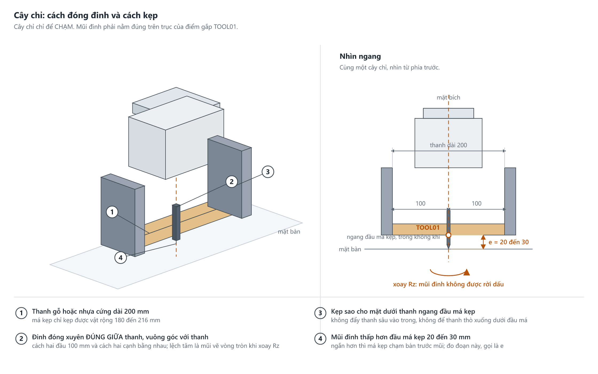
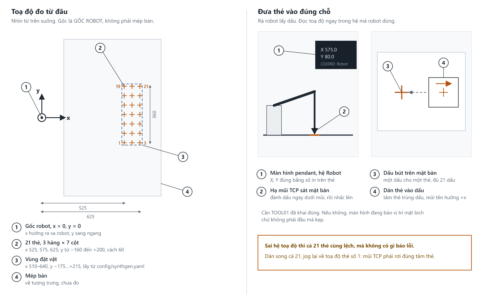
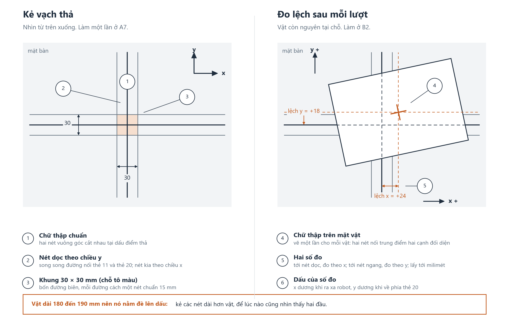
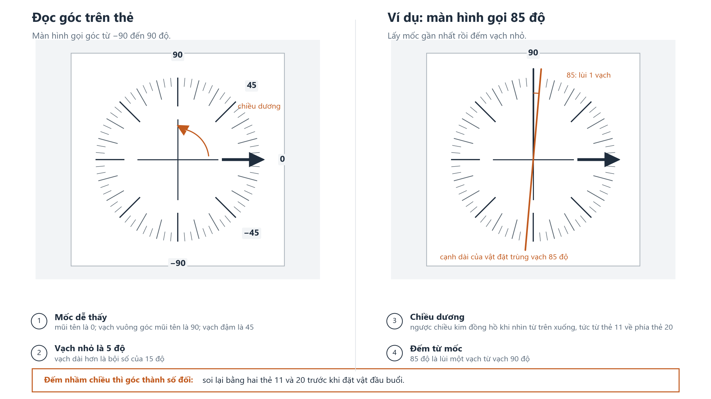
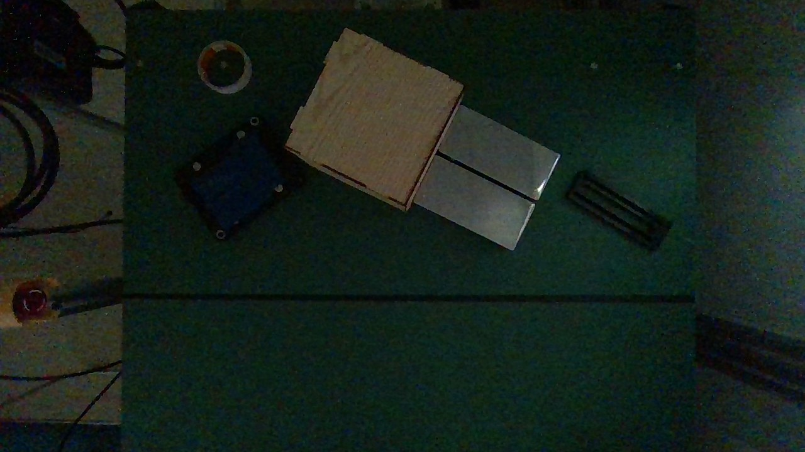
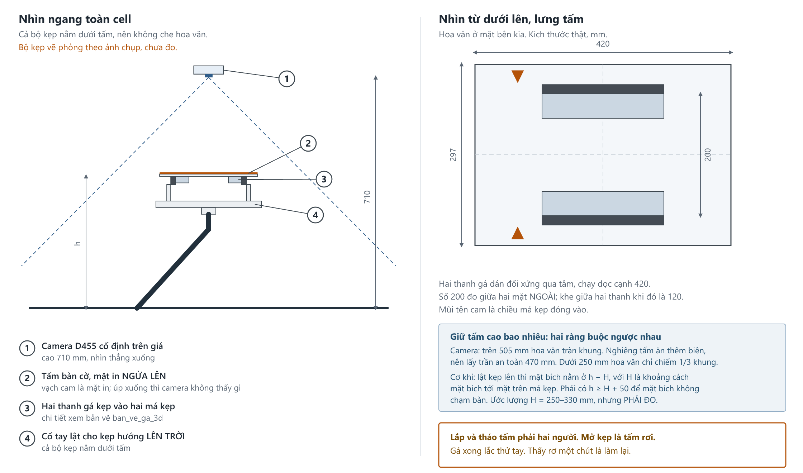
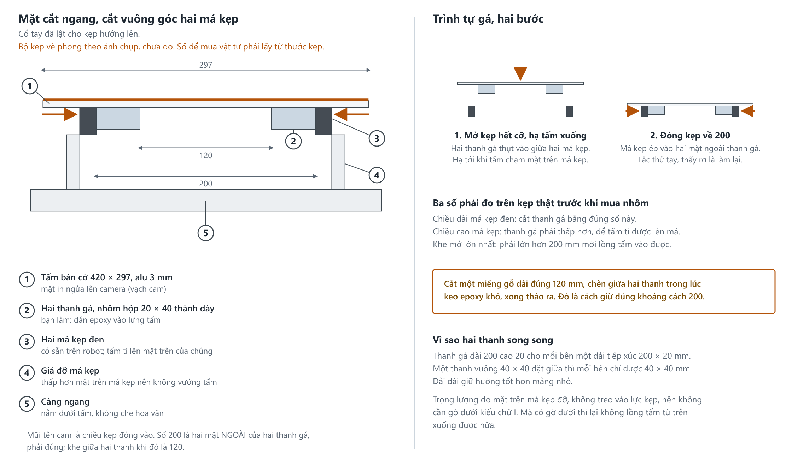

# HƯỚNG DẪN CHẠY THÍ NGHIỆM

**Hiệu chuẩn tay–mắt đã xong, các file kết quả đã có trên git, không làm lại. Chỉ còn kiểm
lại bằng thước kẹp (A3) và chạm thử (A5).**

**Luật chung**

- Robot chỉ tự chạy từ Pha 2. Chép nguyên lệnh trong hướng dẫn, không thêm bớt.
- **DỪNG** nghĩa là: dừng ngay, ghi lại, gửi cho thầy, chờ trả lời. Không tự sửa rồi chạy tiếp.
- Nút dừng khẩn luôn trong tầm tay. Không đưa tay vào cell khi servo bật. Không đổi tốc độ.
- Mọi lệnh gõ trong PowerShell, ở thư mục `DTwinGP7`, sau khi đã chạy `.venv\Scripts\activate`.
  IP tủ điều khiển: `192.168.125.100`.

## Tóm tắt

**Phần A. Robot chỉ jog tay**

| # | Việc | Ghi lại |
|---|---|---|
| A1 | Lấy mã về, chạy `pytest` | số bài `passed` |
| A2 | Kiểm camera còn đúng chỗ | 4 thông số camera; `top`, `tilt` mặt bàn |
| A3 | Thước kẹp đo tấm bàn cờ | cạnh ô, cạnh dấu, độ dày |
| A4 | Khai TOOL01, kiểm vít chỉ | Z của TOOL01 |
| A5 | Chạm thử, ba lần đặt tấm | hai file csv và json của từng lần |
| A6 | Lấy dấu bằng robot, dán 21 thẻ | file `card_targets.png` |
| A7 | Đo điểm thả trên bàn, kẻ vạch thả | X, Y điểm thả; Z điểm thả, Z vùng thẻ |
| A8 | Nhìn kiểm má kẹp, không chỉnh | không có số |

Xong A1 đến A8, gửi các số trên cho thầy rồi sang phần B.

**Phần B. Robot tự chạy**

| # | Chạy gì | Số lượt |
|---|---|---|
| B2 | Pha 2: chạy thử | 1, rồi 5 |
| B3 | Pha 3 (E1): đo độ trễ, telemetry, gắp theo thẻ; điểm công cụ (jog tay) | 50; 20 tư thế |
| B4 | Pha 4 (E2): 2 buổi chuẩn, 2 buổi khó | 340, 340, 140, 140 |
| B5 | Pha 5: 8 buổi, chỉ chạy khi người huấn luyện gửi mô hình mới | xem B5 |

Từ B3 trở đi không đo tay nữa: máy ghi từng lượt, người đặt vật chỉ gõ y hoặc n sau mỗi lượt,
và bấm ENTER sau khi sửa chỗ đặt nếu máy báo lệch (B1, bước 4). Riêng B2 còn một phép đo bằng thước.

**Cần sẵn:** thước kẹp, thước lá, bút dạ, băng dính giấy, băng dính trong, tấm bàn cờ A3 đã in,
hai bộ thẻ vị trí đã in. Vít chỉ đã gắn sẵn dưới bộ kẹp.

---

# PHẦN A. NGÀY ĐẦU

Chỉ jog tay, chế độ TEACH, tốc độ thấp. Bước nào không đạt thì
DỪNG.

## A1. Lấy mã và kiểm máy

Máy cần Python 3.10 trở lên và Git. Lần đầu:

```
git clone -b fix/b3-review https://github.com/manhhv87/DTwinGP7.git
cd DTwinGP7
python -m venv .venv
.venv\Scripts\activate
pip install -r requirements.txt
```

Những lần sau:

```
cd DTwinGP7
.venv\Scripts\activate
git pull
```

Nếu `git pull` báo lỗi vì file ở máy đã sửa (sẽ gặp sau A4 và A7), chạy bốn lệnh này; các số đã
sửa ở máy vẫn được giữ:

```
git checkout -- config/calibration/
git stash
git pull
git stash pop
```

Kiểm máy:

```
git log -1
pytest tests/ -q
python scripts/03_run_experiment.py --mode sim --headless --trials 5
```

**Đạt khi:** `git log -1` hiện mã `4468f8d` hoặc một mã mới hơn; dòng cuối của `pytest` không có
chữ `failed` (một bài `skipped` là bình thường: bài đó cần PyMuPDF, không có trong
`requirements.txt`); lệnh thứ ba tạo một file mới `results\experiment_headless_*.csv` (tỷ lệ `0.0%` ở lệnh
này là bình thường). Một bài test đo nhịp thời gian thỉnh thoảng trượt khi máy bận: hỏng đúng một
bài thì chạy lại `pytest`.

**Ghi:** số `passed`.

## A2. Kiểm camera còn đúng chỗ

Cắm camera D455, chạy:

```
python -c "from src.perception.camera import D455Camera; print(D455Camera().intrinsics)"
```

**Đạt khi:** `ppx` 647,29 và `ppy` 368,78, lệch dưới 0,1; `fx` 645,0 và `fy` 644,2, lệch dưới 1,0.
Hai số `fx`, `fy` nhích vài phần mười giữa hai lần đọc là bình thường (camera tự bù theo nhiệt độ),
không phải hỏng; lệch tới 1,0 chỉ làm sai vị trí dưới 0,4 mm ở thẻ xa nhất.

Dọn bàn trống, jog robot ra ngoài vùng bàn cho khuất camera, rồi chạy:

```
python scripts/02_run_calibration.py --table-only
```

**Đạt khi:** dòng `Table plane:` in `top` từ 591,9 đến 595,9 mm và `tilt` từ 0,12 đến 0,52°.
Lệnh này ghi đè file mặt bàn; đạt thì trả lại file gốc:

```
git checkout -- config/calibration/table_plane.json
```

**Ghi:** bốn thông số camera; `top`, `rms`, `tilt`. Không đạt nghĩa là camera đã bị dịch: DỪNG.

## A3. Đo tấm bàn cờ

Thước kẹp: đo ba ô vuông đen rồi lấy trung bình cạnh ô; đo ba ô dấu ArUco (ô có hoa văn) rồi lấy
trung bình cạnh dấu; đo độ dày tấm.

Đo cạnh ô trên **trọn dải**: kẹp thước hai mép ngoài cùng của sáu ô liền nhau rồi chia sáu. Đo một
ô đơn lẻ không đủ, vì sai số của bản in nhỏ hơn sai số đọc thước.

**Đạt khi:** cạnh ô từ 44,8 đến 45,2 mm; cạnh dấu từ 33,8 đến 34,2 mm.
**Gửi:** ba số đo, kèm một ảnh mặt thước lúc đo. Thiếu số đo: bước này coi như chưa làm.
Không đạt: DỪNG.

## A4. Khai TOOL01, kiểm vít chỉ

TOOL01 là điểm gắp: điểm giữa hai đầu má kẹp. Nếu tấm bàn cờ còn kẹp trên má thì mở má lấy ra
trước.

1. Dùng thước đo từ mặt bích tới đầu dưới má kẹp, dọc trục cổ tay: gọi là Z (kích thước Z trên
   hình 2 ở dưới). **Mặt bích** là mặt phẳng cuối cổ tay robot, chỗ bắt bộ kẹp vào; nếu giữa cổ
   tay và bộ kẹp có tấm đệm thì Z vẫn tính từ mặt cổ tay. **Đầu dưới má kẹp** là chỗ thấp nhất của
   hai thanh má, chỗ chạm vào vật khi kẹp.
2. Pendant, chế độ bảo mật MANAGEMENT: MAIN MENU → ROBOT → TOOL, chọn tool số 1, nhập X = 0,
   Y = 0, Z = số vừa đo.
3. Mở `config\cell_layout_real.yaml`, dòng `tcp_offset_xyz_mm` đang là `[0, 0, 178]`, số đo
   ngày 24/09/2026 của chính cell này. Số vừa đo lệch quá 2 mm thì sửa dòng đó theo số vừa đo
   và ghi vào nhật ký.
4. **Gắn vít chỉ** để chạm được điểm (điểm gắp nằm giữa hai má, không có gì để chạm): bắt hoặc dán
   một con vít dưới **tâm bộ kẹp**, mũi chúc thẳng xuống, mũi thấp hơn đầu má kẹp. Vít đã có sẵn
   trên cell, xem ảnh `anh_vit_chi.jpg` và hình dưới; tháo ra rồi lắp lại thì lắp đúng như cũ.
5. Kiểm: chấm một dấu trên bàn. Chọn TOOL01, hệ Robot, cổ tay chúc thẳng xuống, jog cho mũi vít
   nằm ngay trên dấu, cách mặt bàn 1 đến 2 mm. Bấm phím xoay Rz sang trái rồi sang phải.



**Đạt khi:** mũi vít đứng yên trên dấu khi xoay Rz. Mũi chạy thành vòng tròn nghĩa là vít lệch
tâm: bắt lại vít cho đúng tâm rồi kiểm lại. Bắt đúng tâm mà vẫn chạy vòng thì bộ kẹp lệch tâm mặt
bích: DỪNG, đo đường kính vòng, gửi cho thầy.
**Ghi:** Z đã nhập.

**Cách chạm ở A5, A6, A7:** vít chỉ đã gắn, TOOL01, hệ Robot, cổ tay chúc thẳng xuống. Chỉ jog
tịnh tiến X, Y, Z, không bấm phím xoay. X, Y hiện trên pendant chính là X, Y của mũi vít. Mỗi lần
tháo rồi gắn lại vít, làm lại phép kiểm ở bước 5. **Tháo vít trước khi sang phần B**, để nguyên
thì vít va vào vật và vào mặt bàn khi robot gắp.

## A5. Chạm thử

Chạy ba lần, mỗi lần đặt tấm bàn cờ ở một chỗ khác nhau theo Y. Tấm chỉ trải 225 mm mà vùng đặt
vật rộng 390 mm, nên một chỗ đặt không phủ hết.

| Lần | Tâm tấm | Phủ Y (mm) |
|---|---|---|
| 1 | X 575, Y 20 | −94 tới 135 |
| 2 | X 575, Y −60 | −174 tới 54 |
| 3 | X 575, Y 100 | −14 tới 214 |

Cả ba lần làm trong một buổi, theo đúng thứ tự trên.

**Mỗi lần làm như sau**

1. Gắn vít chỉ, chạm như cuối A4.
2. Jog mũi vít tới X, Y của lần đang làm, hạ xuống sát bàn. Đặt tấm bàn cờ nằm phẳng, mặt in lên,
   **cạnh dài dọc theo trục Y**, tâm tấm ngay dưới mũi. Nâng mũi lên, jog robot ra khuất camera.
3. Chạy, thay ba số đo ở A3:

   ```
   python tools/touch_test.py --square-mm <cạnh ô> --marker-mm <cạnh dấu> --board-thickness-mm <độ dày>
   ```

4. Công cụ lưu ảnh `results\touch_test_<giờ>.png`, trên đó 8 góc ô được khoanh và đánh số, rồi hỏi
   lần lượt từng góc. Mở ảnh, jog mũi vít chạm đúng góc đang hỏi, đọc X và Y trên pendant, gõ hai
   số cách nhau một dấu cách rồi ENTER. Góc nào không với tới thì gõ `s`.

**Đạt khi:** trong `results\` có hai file `touch_test_<giờ>.csv` và `touch_test_<giờ>.json`.

**Gửi ngay sau mỗi lần:** hai file đó, kèm Y tâm tấm của lần vừa chạy. Xong lần 1 thì chờ
thầy trả lời mới chạy lần 2.

**Không sửa file nào trong `config\calibration\`.**

## A6. Lấy dấu và dán 21 thẻ

In `position_cards.pdf` ở 100%, kiểm vạch 50 mm in sẵn phải đúng 50 mm, cắt 21 thẻ theo viền.

1. Gắn vít chỉ, chạm như cuối A4. Với từng thẻ: jog mũi tới đúng X, Y in trên thẻ, hạ mũi chạm
   bàn, chấm một dấu bút dạ. Thẻ 1, 2, 3 ở Y = −160 với X = 525, 575, 625; mỗi hàng sau Y tăng
   60 mm; thẻ 19, 20, 21 ở Y = 200 (hình dưới).
2. Dán thẻ: chữ thập giữa thẻ trùng dấu, mũi tên trên thẻ chỉ ra xa robot (hướng +X). Băng dính
   trong phủ kín thẻ.
3. Kiểm: jog mũi về thẻ 1 (X 525, Y −160) và thẻ 21 (X 625, Y 200).

**Đạt khi:** tới được cả 21 điểm mà pendant không báo giới hạn khớp, và ở bước 3 mũi rơi đúng tâm
chữ thập.

**Gửi:** chạy lệnh dưới, dòng in ra phải là `21/21`, rồi gửi file `results\card_targets.png`.

```
python tools/show_card_targets.py --cards-file config/pose_lists/std_v2.csv.cards.txt --snapshot results/card_targets.png
```



## A7. Điểm thả trên bàn

Điểm thả đo một lần, dùng cho tất cả các buổi của Pha 2 đến Pha 5: không đo
lại, không xê dịch dấu, không sửa lại hai số trong file cấu hình.

1. Kẻ chữ thập lên mặt trên của từng loại vật, mỗi vật một lần: hai nét bút nối trung điểm hai
   cạnh đối diện. Giao điểm hai nét là tâm mặt trên, dùng cho A7 và cho mọi phép đo ở phần B.
2. Chấm một dấu chữ thập nhỏ bằng bút dạ lên một chỗ trống trên bàn, ngoài lưới 21 thẻ, chỗ đủ
   rộng để vật nằm trọn trên bàn và không đè lên thẻ nào.
3. Gắn vít chỉ, chạm như cuối A4: jog mũi tới đúng tâm dấu, hạ chạm, đọc X, Y, Z trên pendant.
   Pendant báo giới hạn khớp thì quay lại bước 2. Hạ mũi chạm mặt bàn ở chỗ bất kỳ trong vùng
   thẻ, đọc Z.
4. Mở `config\experiment.yaml`, tìm dòng `place_position: [700.0, 120.0, 700.0]`: thay hai số đầu
   bằng X, Y vừa đọc, giữ nguyên số thứ ba (không dùng). Lưu file.
5. Kẻ bằng bút dạ theo hình dưới. **Chữ thập chuẩn** là hai nét vuông
   góc cắt nhau tại dấu: nét dọc theo chiều y, song song đường nối thẻ 11 và thẻ 20; nét ngang
   theo chiều x, song song đường nối thẻ 10 và thẻ 12. Các nét đủ dài để hai đầu luôn
   thò ra ngoài vật. Gọi là **vạch thả**.

**Đạt khi:** Z tại điểm thả lệch không quá 3 mm so với Z đọc trong vùng thẻ; Không đạt:
DỪNG.
**Ghi:** X, Y, Z tại điểm thả; Z trong vùng thẻ.



## A8. Má kẹp

Mỗi thanh má bắt vào tay kẹp bằng một con vít và giữ nguyên như hiện tại: không thêm điểm giữ,
không nới vít, không chỉnh thanh. Trục đóng của má lệch góc lệnh khoảng 3,2 độ, đúng cho cả năm
loại vật; phần lệch này đã bù bằng `yaw_offset_deg` và `place_yaw_deg` trong
`config\experiment.yaml`. Độ lỏng hiện tại của thanh má không làm vật rơi hay đặt lệch khung
30 × 30 mm.

**Đạt khi:** bộ kẹp chưa va chạm và nhìn bằng mắt không thanh nào lỏng hay lệch hẳn đi. Không
đạt: DỪNG, chụp ảnh bộ kẹp từ dưới lên, gửi về.

Xong A8: gửi các số của A1 đến A7 về, sang phần B.

---

# PHẦN B. ROBOT TỰ CHẠY

> **BA ĐIỀU KIỆN ĐỂ MỘT BUỔI PHẦN B ĐƯỢC TÍNH**
>
> 1. Từng lượt, vật đặt đúng thẻ, đúng góc và đúng loại mà màn hình gọi, kể cả cỡ hộp carton và
>    vật nằm dưới của lượt xếp chồng.
> 2. Ba số thước kẹp của A3 đã gửi về, sáu dòng đo điểm thả của B2 đã ghi trong
>    `results\pha2\B2_do.csv`.
> 3. Lượt robot không gắp được vật thì chấm `n`.

Phần B có **bốn việc phải chạy**, theo thứ tự: B2, rồi B3, rồi bốn buổi của B4, rồi tám buổi
của B5. Hai mục còn lại **không phải việc, chỉ để tra**: B1 là cách đặt vật và chấm một lượt,
B6 là trình tự của một buổi trong B4 và B5.

Mọi lệnh chạy thật dưới đây đã có `--confirm-each-trial` (robot chờ ENTER trước mỗi lượt) và
`--no-viewport-mirror` (thiếu nó, Ctrl+C không dừng được robot).

## B1. Tra cứu: một lượt gắp, đặt vật và chấm

Trước mỗi lượt, màn hình in dòng gọi rồi dừng chờ. Dòng gọi gồm `card=` (số thẻ), `x=` và `y=`
(hai số in trên thẻ), `yaw=` (góc) và `class=` (loại vật; hộp carton kèm cỡ, `carton(80)` hoặc
`carton(120)`); lượt xếp chồng có thêm dòng `STACKED`. Ở chiến dịch chính, dòng gọi mở đầu bằng
mã A, B hoặc C trong ngoặc vuông:

```
[B] Trial 21/25, PLACE: card=20  x=575.0 mm  y=200.0 mm  yaw=85.0 deg  class=inox_box
    STACKED: put the carton(120) down on the card FIRST, then the inox_box on top of it.
   Placed it? TAKE YOUR HAND OUT of the cell, then press ENTER
```

Ở B3, khối đối chứng và lệnh D, cùng dòng gọi ấy không có mã và đứng sau phần đầu dòng của log,
dạng `13:18:05 | experiment | INFO |`; danh sách tư thế của điều kiện khó còn thêm
`condition=` ở cuối dòng.

**Thẻ, góc, loại vật, cỡ hộp carton và vật nằm dưới trên dòng gọi là ràng buộc của lượt**:
không thay thứ nào trong số đó.

1. **Tìm vạch góc được gọi trên thẻ**, theo hình dưới. Mũi tên là 0 độ, vạch vuông góc mũi tên
   là 90 độ, hai vạch đậm là 45 độ, mỗi vạch nhỏ là 5 độ. Góc dương quay ngược chiều kim đồng
   hồ khi nhìn từ trên xuống.
2. **Đặt vật.** Trước khi hạ vật, đối chiếu thẻ sẽ nằm dưới chữ thập trên mặt vật với dòng gọi,
   vì vật hạ xuống sẽ che kín thẻ: số thẻ trùng `card=`, hai số x, y in trên thẻ trùng `x=`,
   `y=`, vạch góc vừa tìm trùng `yaw=`. Phép đối chiếu này áp dụng ở mọi khối, kể cả các khối của
   chiến dịch chính. Lệch thì đặt vật sang đúng thẻ trước khi bấm ENTER; vật nằm sai thẻ
   thì lượt ấy không dùng được cho phép so ghép cặp. Nhìn thẳng từ trên xuống: chữ thập trên mặt
   vật nằm ngay trên chữ thập giữa thẻ, cạnh dài trùng vạch vừa tìm. Dung sai ±15 mm.
   Lượt có dòng `STACKED` đặt hai vật và dựng đúng như dòng ấy: vật ghi sau `put the` đặt xuống
   thẻ trước và nằm dưới, vật của `class=` đặt lên trên nó. Không bỏ vật nằm dưới, không thay nó
   bằng vật khác hay bằng hộp carton cỡ khác. Ví dụ ở trên nghĩa là đặt hộp carton 120 xuống thẻ
   20 trước, rồi đặt hộp inox lên trên hộp carton. Chữ thập của cả hai vật đều trùng chữ thập
   giữa thẻ. Vật nằm dưới luôn đặt cạnh dài trùng mũi tên, tức 0 độ; góc màn hình gọi là góc của
   vật nằm trên.
3. **Rút tay ra khỏi cell rồi mới bấm ENTER.** Sau ENTER camera kiểm chỗ đặt rồi chụp ảnh cho
   lượt, nên lúc bấm, trong cell không còn tay người và trên bàn chỉ có vật của lượt; suốt buổi, vật dự phòng
   để ngoài bàn, ngoài khung hình camera. Không nhìn màn hình nhận dạng trong lúc đặt.
4. **Sửa chỗ đặt khi máy báo lệch.** Sau ENTER servo vẫn tắt, camera so vật trên bàn với dòng
   gọi. Khớp thì servo bật, camera chụp ảnh của lượt và robot chạy. Không khớp thì màn hình in một
   dòng cho mỗi chỗ lệch (bảng ở dưới hình) rồi dừng chờ. Ví dụ khi thiếu hộp carton nằm dưới:

   ```
      Trial 21: not as called:
        STACK: top at 42 mm, 167 mm expected for inox_box on carton(120); check the support
      Fix it, TAKE YOUR HAND OUT of the cell, then press ENTER
   ```

   Servo vẫn tắt nên tay vào cell được ngay. Đối chiếu vật với dòng gọi như ở bước 2, sửa chỗ
   sai, rút tay ra, bấm ENTER: camera kiểm lại. Máy kiểm tối đa ba lần. Lần thứ ba vẫn lệch thì
   màn hình in `still not as called after 3 checks` cùng dòng
   `Check that the part is placed as called (fix it if not).`: kiểm vật lần cuối, rút tay ra, bấm
   ENTER, lượt chạy với chỗ đặt hiện tại. Vật đã đúng dòng gọi mà máy vẫn báo lệch thì phần sai
   nằm ở camera, và lượt phải chạy để lỗi ấy được tính. Máy ghi lại mọi lần kiểm.
5. **Chấm.** Robot gắp và thả xong, màn hình hỏi `did the robot alone leave the part inside the 30x30 mm frame? [y]=yes  [n]=no`. Nhìn
   thẳng từ trên xuống: gõ **y** nếu chữ thập trên mặt vật nằm trong khung 30 × 30 mm của vạch
   thả; gõ **n** nếu kẹp trượt, vật tuột khỏi kẹp trên đường đi, hoặc chữ thập nằm ngoài khung.
   Lượt bị từ chối trước khi robot chạy, với dòng
   `Trial N: refused before motion (details in the log)`, không có câu hỏi này; vật vẫn nằm trên
   thẻ.
6. **Lấy vật ra ngoài bàn** trong lúc màn hình chờ ENTER của lượt sau: vật ở điểm thả, hoặc vật
   còn trên thẻ nếu robot không chạy. Không với tay vào vùng thả khi robot đang chạy về.



**Phép kiểm chỗ đặt** chạy ở mọi lần chạy có dòng gọi (B3, khối đối chứng, lệnh A và D), trừ
lệnh B, C, E, F: các cấu hình của lệnh C, E, F dùng mô hình nhận dạng khác nhau, nên dòng lệch có
thể khác nhau giữa các cấu hình và để lộ mã nào là cấu hình nào; lệnh B tắt phép kiểm để chạy cùng
quy trình với C, E, F, vì kết quả lệnh B được dùng lại làm cấu hình đối chứng của chúng. Đầu mỗi lần chạy, màn hình in
`Placement check: on` hoặc `Placement check: off`. Dòng lệch giống nhau ở mọi cấu hình; mỗi dòng
nêu số đo, mức mong đợi và chỗ cần kiểm:

| Dòng mở đầu bằng | Nghĩa | Chỗ cần kiểm |
|---|---|---|
| `CLASS:` | không tìm thấy vật đúng loại được gọi | loại vật trên thẻ; lượt xếp chồng thì cả vật nằm dưới |
| `POSITION:` | tâm mặt trên của vật cách thẻ được gọi quá 40 mm | số thẻ, hai số x, y |
| `STACK:` | mặt trên đo được cao hơn mức mong đợi quá 10 mm, hoặc thấp hơn quá 8 mm (mặt hộp inox: 15 mm) | lượt xếp chồng: vật nằm dưới; vật đơn đo cao: vật lót bên dưới; vật đơn đo thấp: loại vật |
| `CARTON SIZE:` | mặt trên khớp mức của hộp carton cỡ kia | cỡ hộp carton |
| `YAW:` | vật lệch góc gọi quá 20 độ; hộp gỗ tính theo chu kỳ 90 độ | vạch góc |

Phép kiểm không thay cho việc đối chiếu ở bước 2. Ngưỡng vị trí của nó rộng hơn dung sai đặt vật
(40 mm so với ±15 mm), nó không thấy hộp gỗ xoay 90 độ, và không phân biệt được hai cách xếp chồng
có mặt trên cao gần bằng nhau, chẳng hạn hộp carton 80 và hộp kim loại làm vật nằm dưới. Không có
câu hỏi chưa có nghĩa là vật đã đặt đúng.

**Cỡ hộp carton.** Trước buổi đầu tiên dùng tới hai hộp carton, mỗi hộp được dán nhãn ở mặt bên
theo cỡ ghi trên dòng gọi: nhãn **80** cho hộp 180 × 100 × 80, nhãn **120** cho hộp
180 × 120 × 120. `carton(80)` hay `carton(120)`, ở `class=` hay ở dòng `STACKED`, là hộp mang
nhãn ấy, dù hộp carton nằm trên hay nằm dưới.

**Trường hợp không suy ra được từ dòng gọi.** `class=wood_box` là hộp vuông 190 × 190 nên không
có cạnh dài: **đánh dấu bút một cạnh** làm cạnh chuẩn và luôn đặt cạnh ấy trùng vạch góc.

Sai cỡ hộp carton hay sai cạnh chuẩn của hộp gỗ thì cùng một tư thế ở hai cấu hình không còn
giống nhau, và phép so ghép cặp mất nghĩa.

**Tự đối chiếu:** cứ mười lượt kiểm lại một lần, loại vật vừa đặt phải trùng loại màn hình gọi ở
lượt đó. Từ hai lượt lệch trở lên: DỪNG.

## B2. Pha 2: chạy thử

**Trước khi xoay chìa TEACH sang REMOTE:** mở `config\experiment.yaml` đối chiếu hai số đầu của
dòng `place_position` đúng X, Y đã đo ở A7; tháo vít chỉ, dọn vật lạ trên bàn, không còn ai trong
cell, nút dừng khẩn trong tầm tay. Xoay chìa xong mới bật servo.

Lượt đầu kiểm trọn một chu kỳ dưới chế độ REMOTE: nhận dạng, giải động học ngược, xuống gắp,
mang sang và thả đúng điểm thả. Thẻ 11 ở giữa lưới 21 thẻ nên tầm với và góc nhìn camera
đều thuận nhất; để một vật duy nhất trên bàn thì nhận dạng không có gì để chọn nhầm.

Đặt hộp carton 120 lên thẻ 11, chữ thập trên mặt hộp trùng chữ thập giữa thẻ, cạnh dài
trùng mũi tên của thẻ, tức vạch 0 độ. Trên bàn không còn vật nào khác. Chạy:

```
python scripts/03_run_experiment.py --mode real --trials 1 --depth-mode rgbd --ik-source yrc --tool-no 1 --confirm-each-trial --no-viewport-mirror
```

Sáu lượt của B2 không chạy theo danh sách tư thế, nên màn hình không in dòng gọi thẻ, góc và
loại vật như ở B1. Nó chỉ hỏi hai câu: trước khi robot chạy là `Placed it? TAKE YOUR HAND OUT
of the cell, then press ENTER`, và sau khi robot thả là
`Trial 1: did the robot alone leave the part inside the 30x30 mm frame? [y]=yes  [n]=no`.

Lượt đầu chạy được thì chạy lại lệnh trên với `--trials 5` thay cho `--trials 1`. Năm lượt này
tự chọn lấy thẻ, vạch góc và loại vật: năm thẻ khác nhau, năm loại vật khác nhau, cạnh dài luôn
trùng một vạch in trên thẻ chứ không đặt lệch giữa hai vạch, trong đó một lượt đặt cạnh dài
**vuông góc với mũi tên** và một lượt đặt theo **vạch đậm 45 độ**. Đặt vật, chấm và lấy vật ra
làm như bước 2, 5 và 6 của B1.

**DỪNG nếu:** preflight báo lỗi; đầu má kẹp xuống gần mặt bàn hơn 20 mm; vật hoặc má kẹp va vào
mép bàn, thẻ hay vật khác; robot đi sai hướng; lỗi `motion_error` lặp lại.

**Đo sau mỗi lượt, khi vật còn ở điểm thả:**

1. Má mở xong, nhìn thẳng từ trên xuống, đo **lệch x** và **lệch y** bằng thước lá theo hướng dẫn bên nửa phải của bản vẽ ở A7, lấy tới milimét. Chữ thập trên vật nằm về phía mũi tên in trong hình thì ghi số dương,
   nằm phía ngược lại thì ghi số âm.
2. Ghi một dòng vào `results\pha2\B2_do.csv` theo mẫu
   `lượt,loại vật,thẻ,góc vạch,lệch x mm,lệch y mm`, cột góc vạch là góc của vạch đã đặt cạnh
   dài vào ở đầu lượt. Sáu lượt cho sáu dòng.
3. Nhặt vật khỏi điểm thả.

Thiếu file này thì A7 chưa được nghiệm thu.
**Ghi thêm:** số lượt hỏng trên 6 và lý do.

Xong, dồn file vào thư mục riêng:

```
mkdir results\pha2
move results\experiment_real_* results\pha2\
move results\telemetry_* results\pha2\
```

## B3. Pha 3: E1, đo nền tảng

`PQM` trong các lệnh là tên viết tắt người đặt vật.

Lệnh 1 đến 5 chạy lần lượt, hết lệnh này mới sang lệnh sau. Ba lệnh đầu không di chuyển robot.
Lệnh 6 chạy riêng, robot chỉ jog tay.

**1. Chạy bộ kiểm thử.**

```
pytest tests/ -q > results/e1_tests.txt
```

**2. So động học thuận với động học ngược.**

```
python scripts/17_compare_fk_ik.py --samples 500 --fair --no-show --out-csv results/e1_fk_ik.csv --out-png results/e1_fk_ik.png
```

**3. Đo độ trễ khứ hồi tới tủ điều khiển.**

```
python tools/hse_rtt.py 192.168.125.100 --n 1000 --csv results/e1_hse_rtt.csv | tee results/e1_rtt_tomtat.txt
```

**4. Gắp 50 lượt theo thẻ**, mỗi lượt làm như B1.

```
python scripts/03_run_experiment.py --mode real --trials 50 --depth-mode rgbd --pose-list config/pose_lists/std_v2.csv --telemetry-hz 10 --session-id e1 --operator-id PQM --ik-source yrc --tool-no 1 --confirm-each-trial --no-viewport-mirror
```

**5. Phân tích telemetry của buổi vừa chạy.**

```
python scripts/05_analyze_telemetry.py latest --no-show | tee results/e1_telemetry_tomtat.txt
```

**DỪNG nếu:** robot tự dừng ngoài ý muốn hoặc mất kết nối.
**Phải có đủ sáu file trong `results\`:** `e1_tests.txt`, `e1_fk_ik.csv`, `e1_fk_ik.png`,
`e1_hse_rtt.csv`, `e1_rtt_tomtat.txt`, `e1_telemetry_tomtat.txt`. Thiếu file nào thì chạy lại
lệnh sinh ra file đó; số liệu chép tay không thay được kết xuất của công cụ.
**Mở hai file `_tomtat.txt`:** có dòng `p95 exceeds 100 ms` thì báo lại, đó là cảnh báo chứ
không phải lỗi.

Xong, dồn file:

```
mkdir results\e1
move results\experiment_real_* results\e1\
move results\telemetry_* results\e1\
```

**6. Điểm công cụ: twin so với tủ điều khiển** (khoảng 30 phút, chạy xong trước buổi `e3-1`
của B5). Chìa ở TEACH, robot chỉ jog tay, tốc độ thấp. Máy tính chỉ đọc vị trí (lệnh HSE 0x75),
không gửi lệnh chuyển động, servo, job hay I/O. Ở mỗi tư thế, máy đọc góc khớp và điểm công cụ
mà tủ điều khiển tính, tự tính điểm công cụ của twin từ cùng góc khớp, rồi ghi khoảng cách giữa
hai điểm.

1. **Chụp màn hình TOOL01.** Pendant: MAIN MENU → ROBOT → TOOL, tool số 1. Ảnh chụp thấy đủ X, Y,
   Z, Rx, Ry, Rz. Không sửa số nào trên màn hình này.
2. **Chọn TOOL01, hệ Robot** trên pendant như khi chạm ở A4, rồi chạy:

   ```
   python scripts/30_measure_tcp_twin_vs_controller.py --hse-ip 192.168.125.100
   ```

   Đầu màn hình phải in `controller reports tool 1; expected 1`. Số tool khác 1 thì chọn TOOL01
   trên pendant trước tư thế 1.
3. **Đọc 20 tư thế** theo bảng dưới, đúng thứ tự. Ở mỗi tư thế: jog tới, buông phím jog, robot
   đứng yên thì bấm ENTER. Máy đọc ba lần cách nhau 0,2 s rồi in toạ độ của tủ điều khiển, của
   twin và khoảng cách `d`. Độ cao tính từ mặt bàn tới đầu dưới má kẹp, ước bằng thước lá.
   **Chúc thẳng xuống** là tư thế cổ tay khi chạm ở A4.

   | Tư thế | Vị trí nhìn từ trên | Độ cao | Cổ tay |
   |---|---|---|---|
   | 1 đến 5 | thẻ 1, 3, 11, 19, 21 | khoảng 50 mm | chúc thẳng xuống |
   | 6 đến 10 | thẻ 1, 3, 11, 19, 21 | khoảng 200 mm | chúc thẳng xuống, rồi xoay Rz 45 độ |
   | 11 đến 14 | thẻ 2, 10, 12, 20 | khoảng 150 mm | chúc thẳng xuống, rồi nghiêng 15 độ: thẻ 2 và 20 quanh Rx, thẻ 10 và 12 quanh Ry |
   | 15 đến 17 | dấu điểm thả | khoảng 50, 150, 250 mm | chúc thẳng xuống |
   | 18 đến 20 | dấu điểm thả | khoảng 150 mm | chúc thẳng xuống, rồi lần lượt: xoay Rz −45 độ; nghiêng Rx 15 độ; nghiêng Ry 15 độ |

   Hai dòng sau không phải lỗi, chỉ cần làm lại tư thế đang đọc:

   | Dòng | Nghĩa | Việc làm |
   |---|---|---|
   | `NOT STILL` | robot còn dịch chuyển trong ba lần đọc; tư thế không được ghi | chờ robot đứng yên, bấm ENTER lại |
   | `TOOL MISMATCH` | tủ điều khiển đang tính theo tool khác TOOL01; dòng này ghi vào CSV nhưng không được tính | chọn TOOL01 trên pendant, bấm ENTER lại ở cùng tư thế |

**Đạt khi:** máy in đủ 20 tư thế có `tool 1`, rồi mục `== Summary ==` với dòng đầu
`Tool point, twin vs. controller, mean / max:`, và trong `results\` có hai file
`e1_tcp_<ngày>_<giờ>.csv` và `e1_tcp_<ngày>_<giờ>_tomtat.txt`.
**DỪNG nếu:** máy in `No position reply from the controller`; `TOOL MISMATCH` vẫn hiện sau khi đã
chọn TOOL01.
**Dòng `CHECK TOOL01`** trong mục tóm tắt nghĩa là chiều dài tool suy ra từ số đọc của tủ điều
khiển lệch quá 2 mm so với `tcp_offset_xyz_mm` của twin. Không sửa TOOL01 trên pendant và không
sửa `config\cell_layout_real.yaml` theo dòng này: quy tắc độ cao gắp đang chạy khớp với TOOL01
hiện có, sửa một trong hai thì độ sâu gắp đổi theo. Kết quả chỉ gửi về.
**Gửi:** ảnh màn hình TOOL01 và hai file `e1_tcp_*`, rồi dồn file:

```
move results\e1_tcp_* results\e1\
```

## B4. Pha 4: E2, bốn buổi

Bốn buổi, chạy theo thứ tự trong bảng. Mỗi buổi làm theo trình tự ở B6; lệnh ở cột Lệnh chiến dịch
chạy ở bước 6.

| Dòng biến | Điều kiện | Lệnh chiến dịch | Số lượt |
|---|---|---|---:|
| `$B = "e2chuan-1"; $F = 0` | chuẩn | A | 300 + 40 đối chứng |
| `$B = "e2chuan-2"; $F = 100` | chuẩn | A | 300 + 40 đối chứng |
| `$B = "e2kho-1"; $F = 0` | khó | B | 100 + 40 đối chứng |
| `$B = "e2kho-2"; $F = 100` | khó | B | 100 + 40 đối chứng |

## B5. Pha 5: tám buổi, khi có mô hình mới

Mọi buổi Pha 5 dùng **điều kiện khó**, trình tự như B6.

**Trước buổi `e3-1`:** lệnh 6 của B3 đã chạy; ảnh màn hình TOOL01 và hai file `e1_tcp_*` đã gửi.

**Vật dự phòng** để ngoài bàn, ngoài khung hình camera, suốt buổi, kể cả lúc đổi vật giữa hai
lượt (B1, bước 3). Vật nằm trong khung hình thì camera thấy thêm một vật không có trong dòng gọi:
robot có thể gắp nó thay cho vật của lượt, và ảnh lưu của lượt không còn là cảnh được gọi.

**Nhận mô hình.** Các file mô hình của Pha 5 chỉ có sau khi huấn luyện E3, E4, E5. Tên file cố
định theo cột `Cần file trong models\` của bảng dưới: người huấn luyện đổi tên mô hình đã chọn
thành đúng tên ấy. SHA-256 của từng file chỉ có sau khi huấn luyện và được gửi kèm file. Chép file
vào thư mục `models\`, giữ đúng tên, rồi kiểm từng file, ví dụ:

```
Get-FileHash models\e3_anchored.pt
```

**Đạt khi:** chuỗi ở cột `Hash` trùng SHA-256 gửi kèm (chữ hoa hay thường như nhau). Khác: DỪNG,
không chạy buổi cần file đó.
**Ghi:** tên file và SHA-256 vào nhật ký của buổi dùng file.

**Không sửa** `model_path` trong `config\experiment.yaml`: khối đối chứng luôn chạy bằng mô hình gốc ghi ở đó, còn mô hình mới đã ghi sẵn trong lệnh.

**Các buổi**, chạy theo thứ tự trong bảng. Buổi nào cần file chưa có thì đợi thầy gửi. Mỗi buổi
làm theo trình tự ở B6; lệnh ở cột Lệnh chiến dịch chạy ở bước 6.

| Dòng biến | Cần file trong `models\` | Lệnh chiến dịch | Số lượt |
|---|---|---|---:|
| `$B = "e3-1"; $F = 0` | `e3_anchored.pt`, `e3_wide.pt` | C | 200 + 40 đối chứng |
| `$B = "e3-2"; $F = 100` | như trên | C | 200 + 40 đối chứng |
| `$B = "e4adapt-1"; $M = "models/e3_anchored.pt"` | `e3_anchored.pt` | D | 80 + 40 đối chứng |
| `$B = "e4adapt-2"; $M = "models/e4_guided1.pt"` | `e4_guided1.pt` | D | 80 + 40 đối chứng |
| `$B = "e4-1"; $F = 0` | `e4_guided2.pt`, `e4_control2.pt` | E | 200 + 40 đối chứng |
| `$B = "e4-2"; $F = 100` | như trên | E | 200 + 40 đối chứng |
| `$B = "e5-1"; $F = 0` | `e5_camera.pt`, `e5_illumination.pt`, `e5_background.pt` | F | 300 + 40 đối chứng |
| `$B = "e5-2"; $F = 100` | như trên | F | 300 + 40 đối chứng |

## B6. Tra cứu: trình tự một buổi của B4 và B5

Lấy một dòng trong bảng ở B4 hoặc B5 rồi làm bước 1 đến bước 8. Mọi lượt ở bước 5, 6 và 7 làm
theo B1.

| Bước | Việc | Robot |
|---|---|---|
| 1 | Đặt biến | đứng yên |
| 2 | Kiểm không còn file rời | đứng yên |
| 3 | Dựng điều kiện | đứng yên |
| 4 | Kiểm điều kiện ảnh | jog tay ra khuất camera |
| 5 | Đối chứng đầu buổi, 20 lượt | tự chạy |
| 6 | Chiến dịch chính | tự chạy |
| 7 | Đối chứng cuối buổi, 20 lượt | tự chạy |
| 8 | Kiểm rồi gửi | đứng yên |

1. **Đặt biến.** Mở PowerShell, `cd DTwinGP7`, `.venv\Scripts\activate`, dán dòng biến của buổi,
   ví dụ:

   ```
   $B = "e2chuan-1"; $F = 0
   ```

   Mở lại PowerShell giữa buổi thì dán lại dòng này.

2. **Kiểm không còn file rời.**

   ```
   dir results\experiment_real_*
   ```

   Phải không in ra gì. Còn file thì dồn về thư mục của buổi trước.

3. **Dựng điều kiện.** Buổi chuẩn: bàn trống, đèn bình thường. Buổi khó: dựng như hai ảnh mẫu
   `anh_mau_bo_kho_1.jpg` và `anh_mau_bo_kho_2.jpg`:

   1. Tấm nền xanh lá phủ kín toàn bộ mặt bàn, cả phía trên lẫn phía dưới vạch đen ngang giữa bàn,
      như trong ảnh mẫu.
   2. Giảm đèn phòng, chốt theo kết quả kiểm ở bước 4.
   3. Dán bộ thẻ thứ hai lên tấm nền, lấy dấu bằng robot như A6. Bộ thẻ này để luôn trên tấm nền.

   Hết buổi khó: cất tấm nền, bật đèn lại.

   

4. **Kiểm điều kiện ảnh.** Bàn để như sẽ chạy nhưng không có vật, robot jog ra khuất camera, rồi
   chạy (buổi chuẩn thay `hard` bằng `std`):

   ```
   python scripts/29_check_condition.py --session $B --condition hard
   ```

   Lệnh đo riêng phần bàn phía trên và phía dưới vạch đen ngang giữa bàn (theo ảnh), in số đo và lưu ba file `results\do_sang_<tên buổi>.png`
   (khung ảnh), `results\do_sang_<tên buổi>_kiem.png` (hai phần đã đo, ô đạt màu tô xanh, ô bàn trần
   tô đỏ) và `results\do_sang_<tên buổi>.txt` (số đo và kết luận).

   **Đạt khi:** buổi khó in `HARD CONDITION: PASS`. Khi in `FAIL`, mỗi dòng dưới nó nêu một nửa bàn
   (`UPPER PART` là phía trên vạch đen, `LOWER PART` là phía dưới) và việc phải sửa: `bare table` là còn chỗ chưa phủ
   tấm nền; `not green enough` là tấm nền không đúng màu; `too dark`
   hoặc `too bright` là chỉnh đèn. Sửa xong chạy lại lệnh, tới khi `PASS` mới sang bước 5. Buổi
   chuẩn không có ngưỡng. **Ghi:** các dòng số đo vào nhật ký.

5. **Đối chứng đầu buổi**, 20 lượt.

   1. Tháo vít chỉ nếu còn gắn, dọn vật lạ trên bàn, không còn ai trong cell, nút dừng khẩn trong
      tầm tay. Xoay chìa TEACH sang REMOTE rồi mới bật servo; chìa giữ ở REMOTE tới hết bước 7.
   2. Chạy lệnh. Gặp tình huống trong danh sách DỪNG của B2 thì dừng.

      **Buổi chuẩn:**

      ```
      python scripts/03_run_experiment.py --mode real --depth-mode rgbd --pose-list config/pose_lists/std_v2.csv --pose-slice 200:220 --session-id $B --block-id doichung-dau --operator-id PQM --ik-source yrc --tool-no 1 --confirm-each-trial --no-viewport-mirror
      ```

      **Buổi khó:**

      ```
      python scripts/03_run_experiment.py --mode real --depth-mode rgbd --pose-list config/pose_lists/hard_v2.csv --pose-slice 200:220 --session-id $B --block-id doichung-dau --operator-id PQM --ik-source yrc --tool-no 1 --confirm-each-trial --no-viewport-mirror --lighting dim
      ```

   3. Dồn file:

      ```
      mkdir results\$B\doichung
      move results\experiment_real_* results\$B\doichung\
      move results\telemetry_* results\$B\doichung\
      ```

6. **Chiến dịch chính.** Chép lệnh mà bảng của buổi gọi tên, từ danh sách ở cuối mục này.

   1. Lệnh A, B, C, E, F: chạy trước một lần có thêm `--dry-run` ở cuối lệnh. Dòng
      `Placement check:` phải ghi `on` với lệnh A và `off` với lệnh B, C, E, F; khác thế thì chép
      lại lệnh. Rồi chạy thật, bỏ `--dry-run`. Lệnh D chạy thẳng.
   2. Trong buổi không mở file khoá trong `results\blinding_keys\` và không mở `logs\experiment.log`.
   3. Dồn file:

      ```
      move results\experiment_real_* results\$B\
      move results\telemetry_* results\$B\
      ```

7. **Đối chứng cuối buổi.** Chạy lại lệnh của bước 5, đổi `doichung-dau` thành `doichung-cuoi`,
   rồi dồn file như bước 5.

8. **Kiểm rồi gửi.** Buổi khó: đổi `std_v2.csv` trong lệnh thành `hard_v2.csv`.

   ```
   python -c "import csv,glob,sys;rows=[d for f in glob.glob(sys.argv[2],recursive=True) for d in csv.DictReader(open(f,encoding='utf-8'))];p={d['pose_id']:d['class_hint'] for d in csv.DictReader(open(sys.argv[1],encoding='utf-8'))};k=[d for d in rows if d['class_name']];m=sum(1 for d in k if d['class_name']==p.get(d['pose_id']));print('dung lop:',m,'/',len(k))" config/pose_lists/std_v2.csv "results/$B/**/experiment_real_*.csv"
   ```

   **Đạt khi:** `dung lop` không dưới 90 phần trăm. Không đạt: DỪNG.

   Đạt thì gom vào thư mục của buổi:

   ```
   copy results\blinding_keys\key_$B.json results\$B\
   copy logs\experiment.log results\$B\
   move results\do_sang_$B* results\$B\
   mkdir results\$B\anh
   Get-ChildItem results\$B -Recurse -Filter "experiment_real_*.csv" | ForEach-Object { Import-Csv $_.FullName } | Where-Object { $_.frame_path } | ForEach-Object { Copy-Item $_.frame_path results\$B\anh\; Copy-Item ($_.frame_path -replace '\.png$','_depth.png') results\$B\anh\ }
   ```

   Ghi trang nhật ký của buổi vào `results\<tên buổi>\nhat_ky.txt`, rồi gửi một thư mục
   `results\<tên buổi>\`. Thư mục `D:\Scientific\Dataset\DigitalTwin\frames` không gửi, chỉ sao
   lưu ra ổ ngoài cùng `results\` và `logs\`.

Chiến dịch dừng giữa chừng (lỗi, dừng khẩn, mất điện): DỪNG, ghi lượt cuối đã chạy, gửi về. Không
chạy lại lệnh chiến dịch với cùng tên buổi.

Được nghỉ giữa buổi, miễn không đổi gì trong cell: camera, đèn, nền, thẻ, người đặt vật.

### Các lệnh chiến dịch

**Lệnh A** (chuẩn, ba cấu hình độ sâu):

```
python tools/run_blinded_campaign.py --arm rgbd "--depth-mode rgbd" --arm plane "--depth-mode plane" --arm fusion "--depth-mode fusion" --pose-list config/pose_lists/std_v2.csv --first-pose $F --trials 100 --block 25 --session $B --operator PQM --common "--mode real --ik-source yrc --tool-no 1 --confirm-each-trial --no-viewport-mirror --save-frames --frames-dir D:/Scientific/Dataset/DigitalTwin/frames"
```

**Lệnh B** (khó, một cấu hình):

```
python tools/run_blinded_campaign.py --arm real_only "--depth-mode rgbd" --pose-list config/pose_lists/hard_v2.csv --first-pose $F --trials 100 --block 25 --session $B --operator PQM --common "--mode real --ik-source yrc --tool-no 1 --confirm-each-trial --no-viewport-mirror --no-placement-check --save-frames --frames-dir D:/Scientific/Dataset/DigitalTwin/frames --lighting dim"
```

**Lệnh C** (E3):

```
python tools/run_blinded_campaign.py --arm anchored "--depth-mode rgbd --model-path models/e3_anchored.pt" --arm wide "--depth-mode rgbd --model-path models/e3_wide.pt" --pose-list config/pose_lists/hard_v2.csv --first-pose $F --trials 100 --block 25 --session $B --operator PQM --common "--mode real --ik-source yrc --tool-no 1 --confirm-each-trial --no-viewport-mirror --save-frames --frames-dir D:/Scientific/Dataset/DigitalTwin/frames --lighting dim"
```

**Lệnh D** (E4, buổi adaptation): một cấu hình, không có mã A, B, không có file khoá; bước 6 vẫn
dồn file như thường.

```
python scripts/03_run_experiment.py --mode real --depth-mode rgbd --model-path $M --pose-list config/pose_lists/hard_v2.csv --pose-slice 220:300 --session-id $B --block-id adapt --operator-id PQM --ik-source yrc --tool-no 1 --confirm-each-trial --no-viewport-mirror --save-frames --frames-dir D:/Scientific/Dataset/DigitalTwin/frames --lighting dim
```

**Lệnh E** (E4, đánh giá):

```
python tools/run_blinded_campaign.py --arm guided2 "--depth-mode rgbd --model-path models/e4_guided2.pt" --arm control2 "--depth-mode rgbd --model-path models/e4_control2.pt" --pose-list config/pose_lists/hard_v2.csv --first-pose $F --trials 100 --block 25 --session $B --operator PQM --common "--mode real --ik-source yrc --tool-no 1 --confirm-each-trial --no-viewport-mirror --save-frames --frames-dir D:/Scientific/Dataset/DigitalTwin/frames --lighting dim"
```

**Lệnh F** (E5):

```
python tools/run_blinded_campaign.py --arm camera "--depth-mode rgbd --model-path models/e5_camera.pt" --arm illumination "--depth-mode rgbd --model-path models/e5_illumination.pt" --arm background "--depth-mode rgbd --model-path models/e5_background.pt" --pose-list config/pose_lists/hard_v2.csv --first-pose $F --trials 100 --block 25 --session $B --operator PQM --common "--mode real --ik-source yrc --tool-no 1 --confirm-each-trial --no-viewport-mirror --save-frames --frames-dir D:/Scientific/Dataset/DigitalTwin/frames --lighting dim"
```

**Tổng số lượt cả phần B**

| Pha | Việc | Lượt chính | Đối chứng |
|---|---|---:|---:|
| 2 | chạy thử | 1 + 5 | |
| 3 | E1 | 50 | |
| 4 | E2 chuẩn, 2 buổi | 600 | 80 |
| 4 | E2 khó, 2 buổi | 200 | 80 |
| 5 | E3, 2 buổi | 400 | 80 |
| 5 | E4 adaptation, 2 buổi | 160 | 80 |
| 5 | E4 đánh giá, 2 buổi | 400 | 80 |
| 5 | E5, 2 buổi | 600 | 80 |

---

## Nhật ký

Máy tự ghi từng lượt vào CSV (kết quả máy, câu trả lời y/n, lý do hỏng, thời gian, toạ độ, thẻ,
buổi, khối, người đặt), telemetry, và toàn bộ màn hình vào `logs\experiment.log`. Người chỉ ghi thứ
máy không biết. Sau mỗi buổi, điền một trang:

| Mục | Ghi gì |
|---|---|
| Tên buổi, ngày, giờ bắt đầu và kết thúc | |
| Người đặt vật | |
| Số lượt đã chạy, số lượt hỏng | |
| Điều kiện phòng | số đo độ sáng đầu buổi; đèn nào bật, có che nắng không, ai đi qua chắn sáng |
| Bất thường | robot dừng, vật rơi, thẻ xê dịch, camera bị chạm, dòng lỗi lộ tên cấu hình |

---

## Phụ lục: hiệu chuẩn lại (chỉ làm khi người huấn luyện yêu cầu)

Chỉ cần khi A2 hoặc A3 không đạt.

1. In `charuco_a3_o45mm.pdf` ở 100%, kiểm vạch 100 mm in sẵn, giấy mặt mờ, dán lên tấm alu phẳng (tấm đang dùng dày 4 mm cả lớp in). Gá
   lên má kẹp bằng hai thanh nhôm hộp 20 × 40 dán ở lưng tấm, hai mặt ngoài cách nhau 200 mm, mặt in
   ngửa lên, tấm cao 250 đến 470 mm trên bàn (hai bản vẽ dưới).
2. Robot ở TEACH, bàn trống, chạy (thay hai số đo mới của tấm):

   ```
   python scripts/02_run_calibration.py --hse-ip 192.168.125.100 --squares 7 5 --square-mm <cạnh ô> --marker-mm <cạnh dấu> --dict DICT_4X4_50 --method park --bootstrap 200
   ```

3. Mỗi tư thế: jog cho camera thấy rõ cả tấm, bấm ENTER, đợi dòng `Captured pose #n`. Lấy 25 đến 30
   tư thế, xoay mặt bích nhiều hướng, rải khắp bàn. Gõ `s` để giải. Rồi tháo tấm, dọn bàn, đưa robot
   ra khỏi tầm nhìn, bấm ENTER để đo mặt bàn.

**DỪNG nếu:** không ra đủ bốn file trong `config\calibration\`, hoặc dưới 25 tư thế.
**Ghi:** `tilt_deg`, `rms_mm` trong `table_plane.json`. Gửi cả bốn file về. Không chạy `git pull`
cho tới khi người huấn luyện báo đã đưa bốn file này lên git. Sau đó làm lại A5.




